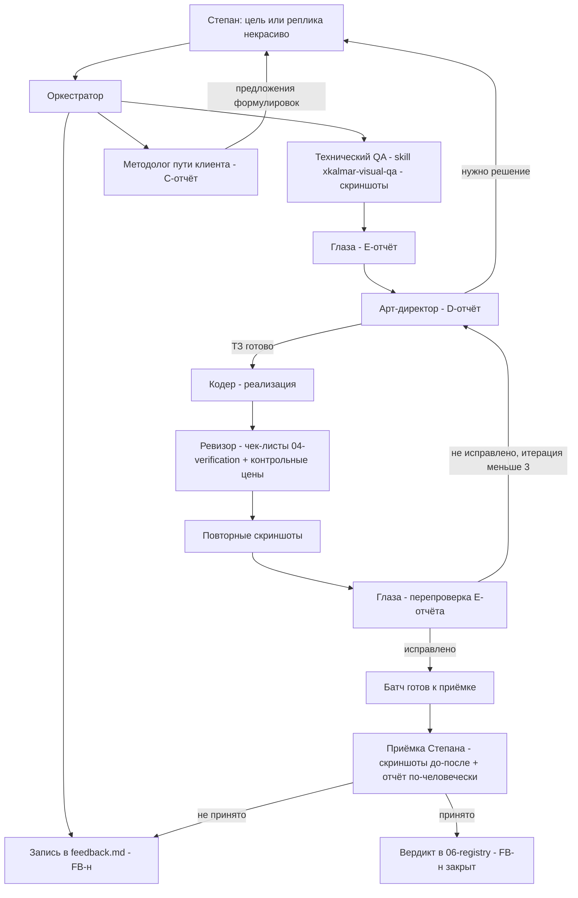

# Система визуально-UX ревью XKALMAR — архитектурный проект

> **Дата:** 2026-11-04 · **Статус:** проект на утверждение Степану.
> **Автор:** Архитектор (сессия проектирования).
> **Назначение:** описать конвейер «замечание → дизайн-решение → код →
> перепроверка» с тремя новыми ролями-агентами, артефактами и журналом
> обратной связи Степана. Код режимов (`.roomodes`) НЕ создаётся —
> его создаёт следующий шаг оркестратора по этому проекту.
> Соблюдает Правило №0, гейты AGENTS.md и запреты 05-safety.md.

---

## 0. Проблема, которую решает система

Сайт функционально работает, но выглядит непрофессионально: отдельные
элементы вызывают у клиента вопрос «почему так реализовано». Степан
не даёт технической обратной связи (не знает CSS), он говорит
человеческим языком: «красиво/некрасиво», «нравится/не нравится».
Сегодня эти реплики теряются между чатами, а технический визуальный
QA (skill `xkalmar-visual-qa`) проверяет «работает/не работает»,
но не «выглядит дорого/дёшево».

Нужен слой **вкуса и понимания клиента** поверх технического QA:
кто-то смотрит КАРТИНКУ, а не код; кто-то превращает «некрасиво»
в конкретное дизайн-решение; кто-то проходит путь клиента глазами
человека, который не знает, что такое «Ярмарка» и почему праздник
стоит в 2–3 раза дороже квеста за 4–6 тыс. ₽.

---

## 1. Три новые роли

Все три роли — **потребители** технического QA, а не его дублёры.
Скриншоты и проверки консоли/сети по-прежнему делает skill
`xkalmar-visual-qa` (или агент, вызвавший его). Роли работают
с готовыми скриншотами из `docs/screenshots/` и живым просмотром.

### 1.1 Роль «Глаза» (визуальный критик) — slug `visual-critic`

**Кто это:** агент, который смотрит на скриншоты как человек-клиент —
родитель, выбирающий праздник за 15–50 тыс. ₽. Его продукт —
**замечания в человеческом языке, структурированные для машины**.

**Вход:**
- скриншоты по skill `xkalmar-visual-qa` (5 разрешений + секции);
- журналы консоли/сети из технического QA;
- [docs/design-system-v2.md](../docs/design-system-v2.md) — как
  справочник «как должно быть», чтобы отличать «некрасиво» от
  «намеренно так»;
- записи из журнала обратной связи Степана (`.agents/feedback.md`)
  со статусом «в работе» — проверять, исправлено ли то, на что
  жаловался Степан.

**Что делает:**
1. Просматривает каждый скриншот как картинку (не читая код).
2. Находит места, которые «притягивают внимание вопросом»:
   диссонанс стилей, кустарность, неряшливость, спорные фото,
   перегруженность, «дёшево смотрится», неопрятные хвосты.
3. Каждое замечание фиксирует карточкой (формат ниже) — на человеческом
   языке, но структурированно и с указанием места на скриншоте.
4. НЕ предлагает решений — только фиксирует и объясняет, ПОЧЕМУ
   это мешает доверять сайту.
5. НЕ открывает код. Единственный разрешённый код-контекст —
   селектор секции из skill'а, чтобы адресовать замечание.

**Формат карточки замечания (в артефакте `E-report`):**

```
### V-<номер>: <название человеческим языком>
- Где: <секция>, <скриншот: файл>, <разрешение>, <где на картинке —
  словами: «справа внизу», «второй экран при прокрутке»>
- Что вижу: <описание как видит клиент: «кнопки разного размера,
  будто разные магазины склеили»>
- Почему мешает: <какие вопросы/недоверие рождает у клиента>
- Острота: критично / заметно / мелочь
- Повторяется на разрешениях: 1440 / 1024 / 768 / 390 / 360
```

**Запреты роли:**
- НЕ менять код, стили, тексты, цены.
- НЕ предлагать CSS/значения отступов — это работа арт-директора.
- НЕ дублировать технический QA (битые img, 404, консоль — это к skill'у;
  «Глаза» только передаёт найденные техQA-аномалии, влияющие на картинку).

**Выход:** артефакт `docs/review/eyes-<дата>-<тема>.md` (E-отчёт).

---

### 1.2 Роль «Арт-директор» — slug `art-director`

**Кто это:** агент со вкусом, который превращает замечания «Глаз»
и недовольство Степана в **конкретные дизайн-решения** — ТЗ для кодера.
Опирается на [docs/design-system-v2.md](../docs/design-system-v2.md)
(токены, типографика, отступы, кнопки, elevation) как на вкус-канон.

**Вход:**
- E-отчёт от «Глаз»;
- записи журнала Степана (сырые цитаты «некрасиво»);
- design-system-v2 (обязателен), design-system.md / design-system-audit.md
  (по необходимости);
- референсы из [docs/qa/ux-audit-den-rozhdeniya.md](../docs/qa/ux-audit-den-rozhdeniya.md)
  (Мир Квестов, Apple HIG, Material 3).

**Что делает:**
1. По каждой карточке V-<номер> принимает решение: **исправить /
   игнорировать с обоснованием / передать Степану на выбор вариантов**.
2. Для «исправить» пишет **дизайн-ТЗ (D-ТЗ)**: что изменить, на что
   менять, со ссылкой на токены/компоненты системы, на человеческом
   языке + точными значениями (кодер сам CSS не «придумывает» вкус).
3. Соблюдает принципы: одна primary-кнопка на экран, «человек за
   3 секунды», токены вместо HEX, состояния обязательны.
4. Когда «правильно» и «вкусно» противоречат текущему коду — указывает
   это в D-ТЗ явно (это задание для кодера, а не вопрос).
5. НЕ трогает: логику калькулятора, цены, канон текстов SPEC-business,
   «не возвращать удалённое» из 05-safety.md (правая колонка, бар,
   absolute-бейджи и т.д. — не предлагать вернуть).

**Формат D-ТЗ:**

```
### D-<номер> (закрывает V-<номер>): <название>
- Решение: <что делаем, в 1–3 предложениях человеческим языком>
- Токены/компоненты: <ссылки на разделы design-system-v2>
- Точные значения: <размеры/отступы/веса/цвета-токены — сколько нужно,
  чтобы кодер не фантазировал>
- Границы: <что НЕ трогаем: логика, тексты, цены>
- Проверка: <как «Глаза» поймут, что исправлено — ожидаемая картинка>
- Статус: ТЗ готово / нужно решение Степана (варианты А/Б)
```

**Выход:** артефакт `docs/review/design-tz-<дата>-<тема>.md` (D-отчёт).
Каждое D-ТЗ = материал для одного ТЗ Аналитика/задачи кодера
(правило «одна задача = одно ТЗ = один коммит» сохраняется: D-отчёт
может разбиваться на несколько задач).

---

### 1.3 Роль «Методолог пути клиента» — slug `cx-methodolog`

**Кто это:** агент, который проходит сайт глазами **неспециалиста** —
родителя, который знает максимум «аниматоры» и ходил на квесты за
4–6 тыс. ₽. Не понимает, что такое «Ярмарка», «под ключ», «банкет»,
и не верит, что праздник в 2–3 раза дороже квеста — это нормально.

**Вход:**
- скриншоты всех состояний пути: вход → первый экран → меню →
  калькулятор → форма → подтверждение;
- UX-линза из [03-conventions.md](../agents/docs/03-conventions.md)
  (родители детей 6–12, 3 секунды на формулировку);
- SPEC-business.md — только чтобы знать, как называются вещи по-настоящему
  (для вопросов), НЕ для правок.

**Что делает (прогон пути, чек-лист C-отчёта):**
1. **Названия и лексика:** понятен ли каждый пункт меню/секции за
   3 секунды без знания специфики? («Ярмарка» вместо «Продление» —
   флаг). Составляет таблицу: термин на сайте → что подумает клиент →
   риск → предложение (если есть).
2. **Путь до заявки:** от первого экрана до отправки формы — есть ли
   ступор? Куда нажимать? Понятно, что произойдёт после нажатия?
3. **Объяснение цены:** сможет ли неспециалист понять, ЗА ЧТО он платит
   больше, чем за квест за 4–6 тыс.? Находятся ли на экране цены рядом
   с объяснением ценности?
4. **Доверие:** рейтинг, отзывы, фото, адрес, телефон — видны ли они
   на пути? Где доверие «проваливается»?
5. **Формулировки:** каждую непонятную фразу — цитата с сайта →
   «как понял клиент» → вариант-предложение.

**Критические ограничения:**
- Методолог **ТОЛЬКО ПРЕДЛАГАЕТ** формулировки. Любая правка текста
  на сайте — только по явному заданию Степана (гейт 3 AGENTS.md).
  Канон — SPEC-business.md, правит его только Степан.
- Предложения формулировок идут в журнал `.agents/feedback.md` и/или
  показываются Степану в отчёте — НЕ в код.

**Выход:** артефакт `docs/review/cx-walkthrough-<дата>-<тема>.md`
(C-отчёт), включая таблицу «термин → непонимание → предложение →
статус решения Степана».

---

## 2. Артефакты конвейера и карта файлов

### 2.1 Карта артефактов

| Артефакт | Кто пишет | Где живёт | Связь |
|---|---|---|---|
| Скриншоты + техQA-отчёт | skill xkalmar-visual-qa | `docs/screenshots/`, `docs/qa/` | вход для «Глаз» и методолога |
| E-отчёт (замечания «Глаз») | visual-critic | `docs/review/eyes-<дата>-<тема>.md` | вход для арт-директора |
| D-отчёт (дизайн-ТЗ) | art-director | `docs/review/design-tz-<дата>-<тема>.md` | вход для кодера/аналитика |
| C-отчёт (прогон пути клиента) | cx-methodolog | `docs/review/cx-walkthrough-<дата>-<тема>.md` | вход для Степана + задачи на тексты (только по его заданию) |
| Журнал обратной связи Степана | любая роль + Оркестратор | `.agents/feedback.md` | принятые решения → 06-registry.md |
| Решения (вердикты) | агент по итогам, вердикт Степана | `.agents/docs/06-registry.md` (как сейчас) | — |

Примечание к 05-safety.md («не создавать md-файлы на всякий случай»):
эта карта файлов **явно утверждается этим документом** и добавляется
в карту AGENTS.md (раздел 6). Файлы создаются только при наличии
реальной задачи, папка `docs/review/` — не «на всякий случай».

Именование тем: короткий slug (`hero`, `calc`, `gallery`, `path-dr`).
Пример: `docs/review/eyes-2026-11-05-calc.md`.

Правило жизненного цикла отчёта: E- и D-отчёты **дополняются**
(статусы карточек обновляются: `новое → в работе → исправлено →
подтверждено Степаном / отклонено`), не плодятся заново на ту же тему.
Новая тема = новый файл.

### 2.2 Журнал обратной связи Степана — `.agents/feedback.md`

**Зачем:** фиксировать ВСЁ, что говорит Степан (идеи, недовольство,
«некрасиво», «сделай по-другому»), в одном месте, чтобы не терялось
между чатами и не приходилось спрашивать по сто раз.

**Структура записи:**

```
### FB-<номер>: <короткий заголовок>
- Дата: YYYY-MM-DD
- Цитата Степана (дословно, своими словами): «...»
- Контекст: <о чём шла речь: страница, секция, скриншот>
- Перевод на язык задач: <что это значит практически, по-агентски>
- Связь: V-<н>, D-<н>, C-<н>, задача/коммит — если есть
- Статус: 💬 новое | 🔧 в работе | ✅ принято (сделано) | ❌ отклонено
  (с причиной) | ❓ открытый вопрос Степану
- Решение Степана: <вердикт и дата, если вынесен>
```

**Правила ведения:**
- Запись создаёт агент в момент, когда Степан что-то сказал, — сразу,
  даже если непонятно, что с этим делать. Непонятно = статус
  «открытый вопрос».
- Цитата — дословно. Перевод — отдельным полем. Перепутать их местами
  запрещено (Правило №0: снимок мысли Степана важнее интерпретации).
- Номера FB — сквозные, не переиспользовать.
- Отклонённое НЕ удаляется — статус ❌ + причина (аналог «не возвращать
  удалённое»: однажды отклонённую идею не поднимать самовольно).

**Связь с 06-registry.md:**
- `feedback.md` — **входящая очередь** (сырая обратная связь и её судьба);
- `06-registry.md` — **журнал вердиктов** (когда Степан вынес решение,
  оно дублируется в «Журнал решений» 06-registry одной строкой:
  `| дата | решение | FB-<н> |`);
- открытые вопросы из feedback.md, зависшие дольше рабочего цикла,
  попадают в раздел «Открытые вопросы» 06-registry.md, чтобы не потеряться;
- известные баги, обнаруженные через обратную связь, — в «Известные баги»
  06-registry с пометкой источника FB-<н>.

---

## 3. Конвейер визуально-UX ревью

### 3.1 Схема цикла



### 3.2 Когда включать какую роль

- **«Глаза»** — после любой правки, затрагивающей видимый интерфейс
  (вместе/после технического QA), и при первом появлении жалобы Степана.
- **«Арт-директор»** — когда есть E-отчёт с непустыми замечаниями или
  сырая жалоба Степана, требующая решения.
- **«Методолог»** — при запуске/изменении страниц, секций, меню,
  формулировок, а также периодически (полный прогон пути после
  крупных изменений воронки). Не нужен для точечных CSS-правок.

### 3.3 Правила цикла

1. **Максимум итераций внутри цикла: 3** на одно замечание
   (замечание → решение → код → перепроверка = 1 итерация).
   После 3-й неудачной итерации замечание уходит Степану с описанием
   «что пробовали, почему не срастается» и 2–3 вариантами от
   арт-директора. Не крутиться бесконечно.
2. **Приёмка Степана — по батчам, не по мелочи.** Звать Степана, когда
   готова связная порция: D-ТЗ реализованы, «Глаза» подтвердили,
   ревизор прогнал контрольные цены. Приёмка = скриншоты до/после +
   отчёт человеческим языком (гейт 2 AGENTS.md).
3. **Всегда звать Степана** (без исключений): правки текстов и цен
   (гейт 3), выбор из вариантов А/Б от арт-директора, противоречия
   «вкус vs система», достигнут лимит 3 итераций.
4. **Разногласия «по коду чётко, а Степан недоволен»:** действует
   Правило №0 — факт Степана прав. Порядок: (а) фиксируем FB-запись
   с дословной цитатой; (б) «Глаза» смотрят тот же фрагмент и
   формулируют, что может видеть клиент; (в) если агенты по-прежнему
   считают «по коду правильно» — помечаем FIXME-REVIEW, создаём
   открытый вопрос и приносим Степану 2–3 варианта, а НЕ спорим и
   НЕ чиним самовольно. Код не возвращаем к прежнему виду и не
   «улучшаем» молча.
5. **Коммит** — после прохождения верификации (гейт 1): без пуша,
   деплой только по команде Степана.
6. **Одна задача = одно ТЗ = один файл = один коммит** сохраняется.
   D-отчёт на 10 замечаний — это 10 задач (или одна, если замечания
   в одной секции и одном стиле правки — решает Оркестратор).

### 3.4 Анти-дублирование с техническим QA

| Проверка | Кто делает |
|---|---|
| Скриншоты по разрешениям, консоль, сеть, alt, lazy | skill xkalmar-visual-qa (как есть, без изменений) |
| Контрольные цены калькулятора | Ревизор по 04-verification (как есть) |
| «Выглядит профессионально? вызывает ли вопросы?» | «Глаза» |
| «Как исправить красиво?» | Арт-директор |
| «Понятно ли человеку, дойдёт ли до заявки?» | Методолог |

«Глаза» и методолог не запускают техQA повторно — запрашивают
свежие скриншоты у роли, которая его уже сделала, либо просят
сделать по skill'у, если скриншоты устарели (старше текущей правки).

---

## 4. Правки маршрутизации в AGENTS.md

### 4.1 Новые строки в таблицу «Маршрутизация»

| Тип задачи | Читать обязательно | Читать по необходимости |
|---|---|---|
| Степан сказал «некрасиво / не нравится / почему так» | `.agents/feedback.md` (записать FB), план ревью `plans/sistema-vizualnogo-ux-revyu.md` | E-отчёты в `docs/review/` |
| Дизайнерский разбор страницы (взгляд клиента) | роль «Глаза» (visual-critic), skill xkalmar-visual-qa | `docs/design-system-v2.md` |
| Превратить замечание в дизайн-решение / ТЗ на красивость | роль «Арт-директор» (art-director), `docs/design-system-v2.md` | `docs/qa/ux-audit-den-rozhdeniya.md` |
| Понятность, названия, путь клиента, доверие, объяснение цены | роль «Методолог» (cx-methodolog), 03-conventions.md (UX-линза) | SPEC-business.md (только читать) |

(формат строк — как в существующей таблице; при переносе в AGENTS.md
пути ролей уточняются после создания файлов режимов оркестратором.)

### 4.2 Дополнение раздела «Модель ролей (конвейер)»

После «Визуальный QA (skill)» вставить:
«→ Дизайнерское ревью: Глаза (E-отчёт) → Арт-директор (D-ТЗ) →
кодер → перепроверка Глазами (макс. 3 итерации) → Приёмка Степана».
Отдельной строкой: «Методолог пути клиента (C-отчёт) подключается
к задачам страниц, лексики и воронки; формулировки — только
предлагает, канон SPEC-business».

### 4.3 Дополнение «Карты файлов-инструкций»

- `.agents/feedback.md` — журнал обратной связи Степана (вход, судьба каждой реплики)
- `plans/sistema-vizualnogo-ux-revyu.md` — проект системы ревью (этот документ)
- `docs/review/` — артефакты ревью: eyes-*, design-tz-*, cx-walkthrough-*
- `.agents/roles/` — инструкции трёх ролей (создаёт оркестратор): `visual-critic.md`, `art-director.md`, `cx-methodolog.md`

### 4.4 Дополнение в 06-registry.md

В «Журнал решений» (по утверждении системы) строка:
`| 2026-11-04 | Введена система визуально-UX ревью: роли Глаза / Арт-директор / Методолог; журнал feedback.md | Степан (утверждение проекта) |`

---

## 5. Что делает оркестратор следующим шагом (не входит в этот проект)

1. Создать файлы режимов/ролей по этому проекту:
   `.agents/roles/visual-critic.md`, `.agents/roles/art-director.md`,
   `.agents/roles/cx-methodolog.md` (содержание разделов 1.1–1.3
   переложить в инструкции ролей), и настроить 3 новых режима.
2. Создать пустой `.agents/feedback.md` с шапкой и форматом из раздела 2.2.
3. Внести правки в AGENTS.md (раздел 4) и одну строку в 06-registry.md.
4. Создать папку `docs/review/` (с ней появится первый E-отчёт).
5. Прогнать первый полный прогон: техQA → Глаза → Арт-директор по
   главной странице, собрать батч для первой приёмки Степана.

## 6. Ограничения проекта (повтор гейтов, чтобы не потерялись)

- Пуш/деплой — только по явной команде Степана.
- Приёмка Степана обязательна для каждой задачи, затрагивающей вид.
- Цены, формулы, канон текстов SPEC-business — только по явному заданию;
  методолог предлагает, Степан решает.
- «Не возвращать удалённое» из 05-safety.md распространяется и на
  дизайн-предложения арт-директора.
- Технический QA остаётся без изменений; новые роли его потребляют.
